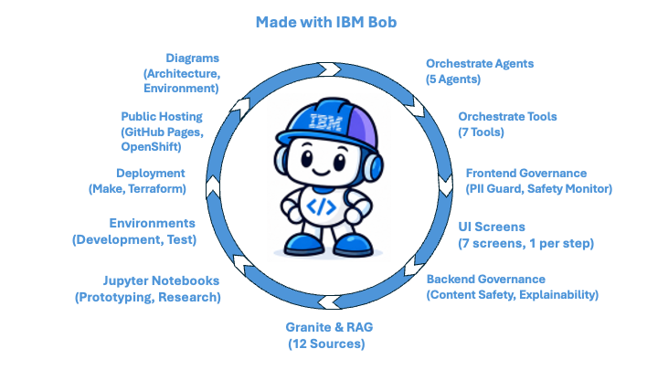

# **Mission Veteran AI** *by G3*

An AI-powered career-transition chatbot made with IBM Bob for veterans and transitioning service members with military computer and IT experience.

Veterans describe their responsibilities and achievements. The chatbot then identifies transferable skills in computer systems, IT support, data analysis, and cybersecurity, and drafts clear, civilian-ready résumé accomplishments, preserving measurable results and allowng veterans to review and approve each statement. 

Our mission is to help veterans market their genuine technical experience and improve their opportunities to obtain civilian IT jobs.

| Index | Component | Document | Products Used | 
| :---: | :---:     | :---:    | :---:          | 
| 1 | Main Agent & Subagents | [Orchestrate](docs/orchestrate.md) | watsonx Orchestrate |
| 2 | Toolkits/Tools | [Orchestrate](docs/orchestrate.md) | watsonx Orchestrate |
| 3 | Guards & Safety | [Governance](docs/governance.md) | watsonx.governance |
| 4 | UI Screens | | | 
| 5 | Factsheets & Monitors | [Governance](docs/governance.md) | watsonx.governance |
| 6 | Granite & RAG | [RAG Sources](docs/rag_sources.md) | watsonx Orchestrate |
| 7 | Jupyter Notebooks | [Notebooks](docs/notebooks.md) | watsonx.ai |
| 8 | Environments | | |
| 9 | Deployment | | Make, Scripts, Terraform |
| 10 | Public Hosting | GitHub Pages & OpenShift |
| 11 | Diagrams | [Architecture](docs/architecture.md) [Environment](docs/environment.md) | |

---

# License

This application is licensed under the Apache License, Version 2.  Separate third-party code objects invoked by this application are licensed by their respective providers pursuant to their own separate licenses.  Contributions are subject to the [Developer Certificate of Origin, Version 1.1](https://developercertificate.org/) and the [Apache License, Version 2](https://www.apache.org/licenses/LICENSE-2.0.txt).

